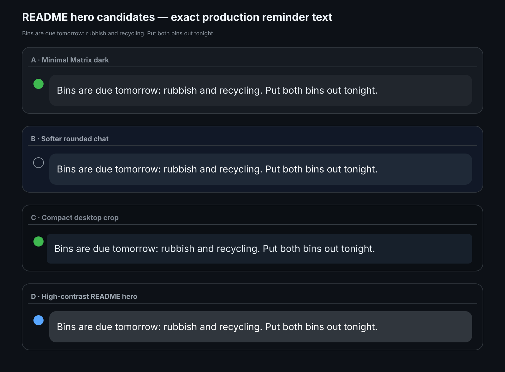

# Auckland Bin Notifier



Matrix reminders for Auckland Council rubbish and recycling collections. Supports property-specific collection pages or iCalendar feeds. Unofficial; not affiliated with Auckland Council.

## Setup

Requires Python 3.11+, [uv](https://docs.astral.sh/uv/), Linux/systemd, and a Matrix account.

```sh
git clone https://github.com/brandonp2412/auckland-bin-notifier.git
cd auckland-bin-notifier
uv tool install .
mkdir -p ~/.config/auckland-bin-notifier ~/.config/systemd/user
cp config.env.example ~/.config/auckland-bin-notifier/config.env
cp matrix.env.example ~/.config/auckland-bin-notifier/matrix.env
```

Choose one source in `config.env`:

- `AUCKLAND_BIN_PROPERTY_ID`: [find your address on Auckland Council's site](https://www.aucklandcouncil.govt.nz/en/rubbish-recycling.html); copy the 11 digits before `.html` in the property's URL.
- `AUCKLAND_BIN_ICS_URL`: paste a direct `.ics` or `webcal://` bin-calendar subscription URL, if you have one (not a PDF). Otherwise use the property ID.

Set `MATRIX_ROOM_ID` in `matrix.env`. For encrypted rooms, run `auckland-bin-matrix-login`; for unencrypted rooms, set `MATRIX_HOMESERVER` and `MATRIX_ACCESS_TOKEN`.

```sh
auckland-bin-notifier --dry-run
cp systemd/*.service systemd/*.timer ~/.config/systemd/user/
systemctl --user daemon-reload
systemctl --user enable --now auckland-bin-notifier.timer
```

Checks once at 5:30 PM (Pacific/Auckland), with no retry or catch-up delivery. Duplicate reminders are suppressed; food scraps are excluded.

Optional encrypted personal DM: set AUCKLAND_BIN_DM_ENV to the bot SDK credential file, plus AUCKLAND_BIN_DM_USER_ID and AUCKLAND_BIN_DM_ROOM_ID to its verified sender and private room. Group and DM sends are independently deduplicated.

For a live Matrix test without affecting reminders, set `MATRIX_E2E_TEST_ROOM_ID` in `config.env` to a room accessible to the dedicated SDK account in `matrix-sdk.env`, then run `auckland-bin-notifier --e2e-test`. E2E runs use the dedicated account while production uses `matrix.env`.

MIT licensed. See [LICENSE](LICENSE).
